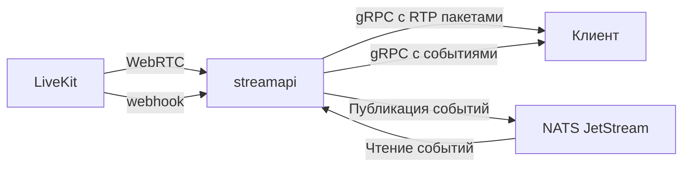

# streamapi

Сервис для получения медиа и событий звонков OpenVidu/LiveKit через gRPC

## API

- [MediaService.Subscribe](api/proto/streamapi/v1/media.proto) Подписка на аудио и видео звонка с фильтрами по участнику, дорожке и виду медиа. Возвращает описание дорожек, RTP пакеты и уведомления о завершении дорожек
- [EventService.Subscribe](api/proto/streamapi/v1/events.proto) Подписка на события звонка с фильтрами по участнику и типу события. События поступают из подписанных HTTP webhooks LiveKit через NATS JetStream

## Архитектура

- `Manager` хранит состояние звонков и подписок в памяти. На звонок создается одно подключение к LiveKit в пределах реплики. После отключения последнего подписчика подключение закрывается. При перезапуске реплики активные подключения и очереди теряются. После обрыва gRPC потока клиент подписывается заново
- `Source` подключается к LiveKit как скрытый участник с правом получения медиа. WebRTC обрабатывает LiveKit SDK; streamapi читает RTP пакеты и передает их без декодирования через gRPC
- На звонок работает горутина управления подключением, на дорожку запускается горутина чтения RTP, на подписку запускается горутина отправки. Фиксированного пула воркеров нет
- У каждого подписчика своя очередь и фильтры. Лимиты очереди и таймаут отправки ограничивают накопление данных; подписка медленного клиента закрывается. Распределение RTP использует атомарный снимок подписчиков, у каждой очереди свой мьютекс
- `Dispatcher` распределяет события из NATS между подписчиками. Каждая реплика читает новые события своим consumer; API подписки не поддерживает чтение истории
- Клиент передает в metadata `x-call-id`, равный `call_id` запроса. В конфигурации NGINX из deployer этот заголовок направляет подписки одного звонка на одну реплику. `call_id` соответствует SID комнаты LiveKit, `room_name` содержит ее имя

Через `ActionService.SendEvent` плагин передаёт SID звонка, UUID активации, имя события, список identity получателей и строку данных. Streamapi проверяет активную активацию через plugin manager и принадлежность получателей звонку. Пустой список получателей запрещён.

Событие `microphone.mute` заглушает опубликованные микрофонные дорожки одного указанного участника; данные для него должны быть пустыми. Если дорожек несколько, при ошибке часть из них уже может быть заглушена.

Событие `participant.remove` отключает одного участника; данные должны быть пустыми. В self-hosted LiveKit удаление само по себе не запрещает повторное подключение с действующим токеном.

Событие `participant.permissions.update` изменяет права одного участника. Данные — JSON с одним или несколькими булевыми полями `canPublish`, `canSubscribe`, `canPublishData`, `canUpdateMetadata`, например `{"canPublish":false}`. Остальные права сохраняются. Одновременные изменения прав могут перезаписать друг друга, так как LiveKit принимает весь набор прав.

Остальные имена доставляются участникам через LiveKit с темой `plugin.event.v1`: JSON содержит `activationId`, `callId`, `name`, `data`. Успех подтверждает отправку LiveKit, а не обработку интерфейсом; отключённый участник не получит событие. Доставка в iframe требует подключения реальных активаций в Meet.

Для действий в конфигурации указываются `actions.manager_url` и `actions.token`; токен передаётся в gRPC metadata `authorization: Bearer <token>`. Без этих параметров действия недоступны. Токен общий: он не подтверждает личность отдельного плагина и не проверяет его права на действие.
